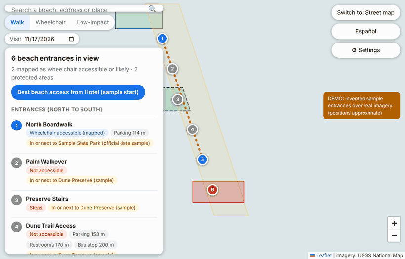

# Beach Access Pathfinder

**Find the best way to the beach, without harming the beach.** Pick a starting point and the app finds beach entrances nearby, routes you to one on the real walking network, and keeps you out of protected areas, posted closures and rising tides. It works for people walking, using wheelchairs or strollers, or trying to tread lightly.



<sub>The demo uses invented sample entrances placed over real USGS aerial imagery near Daytona Beach, so it runs without any live data. The live app uses real mapped entrances.</sub>

**Try it:** [live app](https://samvelasco.github.io/Beach-Access-Pathfinder/) · [offline demo](https://samvelasco.github.io/Beach-Access-Pathfinder/demo.html) · install it on a phone with *Add to Home Screen* (iPhone) or *Install app* (Android).

## Contents

[What it does](#what-it-does) · [How to use it](#how-to-use-it) · [Where the data comes from](#where-the-data-comes-from) · [Run it yourself](#run-it-yourself) · [Publishing and maintaining](#publishing-and-maintaining) · [Notes](#notes) · [Project layout](#project-layout) · [Roadmap](#roadmap)

## What it does

**Finds and ranks beach entrances.** Entrances are inferred from mapped trails and boardwalks that reach mapped beach, with wheelchair accessibility (from OpenStreetMap tags), parking, restrooms and bus stops nearby.

**Routes with conservation in mind.**
- Routes cost more through protected areas (six times more in Low-impact mode), and each route lists which protected areas it crosses.
- Official USGS PAD-US protected areas are merged with OpenStreetMap ones.
- FWC Critical Wildlife Areas (dune and shorebird closures) use their real yearly dates. An active closure blocks routes through it and marks entrances inside it as closed.
- During sea turtle nesting season, Low-impact mode also avoids walking on the beach itself.

**Fits how you travel.** Walk, Wheelchair/stroller (no steps, avoids sand and steep inclines) or Low-impact.

**Shows who is left out.** Orange dotted lines mark shoreline stretches with no mapped accessible entrance.

**Checks the tide.** NOAA's predicted water level is compared with USGS ground height at the sand points on your route, and the app warns of the hours the tide may cover it.

**Guides you there.** The walk-through gives turn-by-turn instructions as a simulated walk (1×, 4×, 10×) or live GPS while you walk, and shows the street-level photo nearest to you.

**Gets better with community input.** Tap the map and choose *Report an issue here* for a blocked walkover, a posted closure, a hazard or an accessibility feature.

**Works for more people.** English and Spanish, and it installs as a phone app with an offline shell.

## How to use it

1. Search a place or tap the map, then choose **Start here** (or use **My location**).
2. Press **Best beach access**. Entrances are ranked by travel time for your mode and visit date.
3. Open a route to see distance, surface mix, protected land crossed, tide and closure warnings, and street-level photos.
4. Press **Start walk-through** to follow it. Use **Settings** to switch language, toggle layers or add a Mapillary token.
5. Pan to another stretch of coast and press **Search this area**.

## Where the data comes from

| What | Source | Notes |
| --- | --- | --- |
| Beaches, trails, amenities | OpenStreetMap via Overpass | Loaded live for the area on screen |
| Protected areas | OpenStreetMap and USGS PAD-US | Biodiversity-managed or conservation-designated lands |
| Dune and shorebird closures | FWC Critical Wildlife Areas, `data/closures.json`, reports | Florida only for the FWC layer |
| Tides and water levels | NOAA CO-OPS | Nearest station; NAVD88 predictions |
| Ground height | USGS 3DEP elevation service | Used for the tide check |
| Imagery | USGS National Map aerial, OpenStreetMap street map | Google imagery can't be embedded |
| Street-level photos | Mapillary (free token) or Wikimedia Commons | Can be old or missing |

## Run it yourself

No build step. You need an internet connection and Node 18+ for the tests.

```
npm run serve      # then open http://localhost:8080 in Chrome (location works on localhost or https)
npm test           # fixture tests: parsing, routing, closures, tide check, photos, reports, Spanish
```

For sample entrances over real imagery, open `http://localhost:8080/?demo=1` or `demo.html`. The entrances, trails and preserve in demo mode are invented.

## Publishing and maintaining

Every push to `main` runs the tests and publishes to GitHub Pages (`.github/workflows/pages.yml`). One-time setup: **Settings, Pages, Source: GitHub Actions**.

- **Closure notices:** add entries to `data/closures.json` (instructions are in the file).
- **Community reports:** *Share with maintainers* opens a GitHub issue labelled `report`. Review it, then copy the entry into `data/community-reports.json`. Reports saved without sharing stay on that person's device.
- **Settings for your deployment** live in `js/config.js` (reports repository, default language).

## Notes

- **OpenStreetMap is volunteer-mapped.** Entrances are inferred, so some real ones may be missing or mislabeled. "Wheelchair accessible" means *mapped as* accessible, not verified.
- **Closures apply only where posted.** There is no live statewide feed for temporary dune, turtle or shorebird postings, so those need curated entries or reports. Always follow signs on site.
- **Turtle nesting dates are a placeholder** (May 1 to Oct 31). Confirm them with your county.
- **The tide check is a prediction.** It ignores waves, storm surge and erosion, uses a 1 ft safety margin, and needs a nearby NOAA station with NAVD88 predictions.
- **Community reports live on the device** until a maintainer adds them to the shared file; a static site has no database.
- **Routes follow mapped paths and streets only.** Slope along a path is not computed; only OpenStreetMap `incline` tags are used.

## Project layout

| File | Role |
| --- | --- |
| `index.html`, `styles.css`, `js/app.js` | Map interface |
| `js/osm.js`, `js/router.js`, `js/geo.js` | Live data, walking graph, routing, entrance detection, accessibility gaps |
| `js/official.js`, `js/closures.js` | PAD-US and FWC data; closure date windows |
| `js/tides.js`, `js/tidecheck.js` | NOAA tides; water level vs. ground height |
| `js/photos.js`, `js/reports.js` | Street-level photos; community reports |
| `js/i18n.js`, `js/config.js` | English/Spanish; deployment settings |
| `sw.js`, `manifest.webmanifest`, `icons/` | Installable offline app |
| `data/` | Curated closures and reviewed community reports |
| `js/demo-data.js`, `demo.html` | Invented sample coastline for demo mode |
| `tests/` | Fixture tests on hand-made data (not real data) |
| `docs/` | Method notes and the demo GIF |
| `vendor/leaflet/` | Leaflet 1.9.4 (BSD-2) |

## Roadmap

- LiDAR slope along paths and a flood-extent overlay from remote sensing
- County-level turtle nesting dates and a live closure feed where one exists
- Census demand for a fuller equity score
- A shared database for community reports

Inspired by Rugged SystEMS (terrain-aware least-cost routing) and the Beach Access Pathfinder plan.
Data © OpenStreetMap contributors (ODbL); imagery: USGS National Map; tides and water levels NOAA CO-OPS; elevation USGS 3DEP; protected areas USGS PAD-US; critical wildlife areas FWC; photos Mapillary (CC BY-SA) and Wikimedia Commons.
